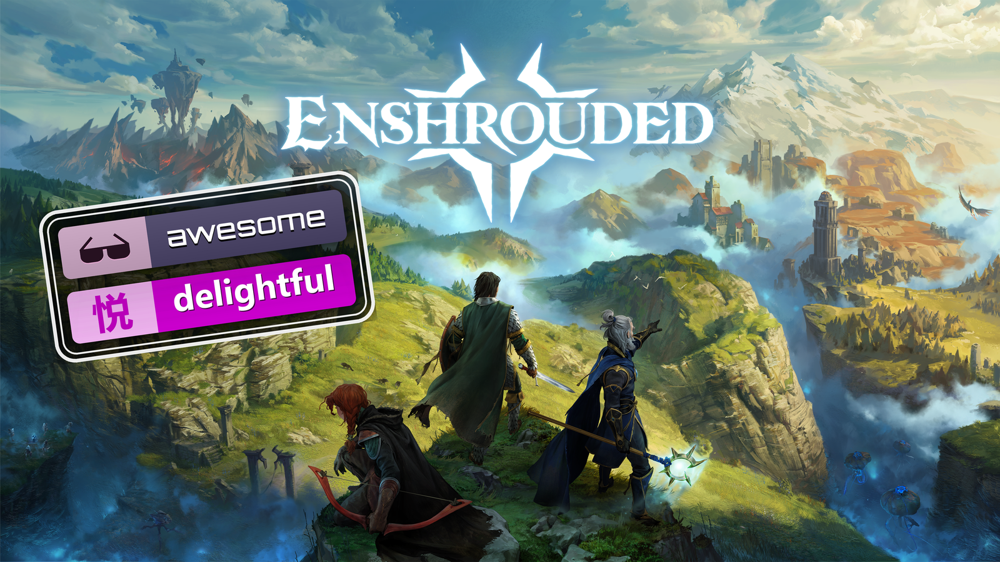

# Awesome & Delightful Enshrouded Links

> A curated hybrid of an awesome list and a delightful list for Enshrouded: interactive maps, building and voxel guides, crafting planners, mods, dedicated server tools, and communities.

Inspired by [delightful-clair-obscur](https://codeberg.org/ClairLibre/delightful-clair-obscur), the [delightful list format](https://codeberg.org/teaserbot-labs/delightful) and the [awesome manifesto](https://github.com/sindresorhus/awesome).

**Scope:** Enshrouded and the community around it.  
**Last researched:** 2026-10-25.

## Contents

1. [Explore & Learn](#explore--learn)
    1. [Maps & Guides](#maps--guides)
    1. [Materials & Crafting](#materials--crafting)
    1. [Combat & Enemies](#combat--enemies)
1. [Build & Customize](#build--customize)
    1. [Building & Voxel](#building--voxel)
    1. [Tools & Planners](#tools--planners)
    1. [Mods & Embervale Toolkit](#mods--embervale-toolkit)
    1. [Sparkworks & Automation](#sparkworks--automation)
1. [Run & Fun](#run--fun)
    1. [Dedicated Servers & Admin](#dedicated-servers--admin)
    1. [Gameplay](#gameplay)
    1. [Lore](#lore)
1. [Community & News](#community--news)
    1. [Official - Keen Games](#official---keen-games)
    1. [News & Updates](#news--updates)
    1. [Communities & Creators](#communities--creators)
    1. [Streams & Videos](#streams--videos)
    1. [Other Link Collections](#other-link-collections)

## Explore & Learn

### Maps & Guides

> Community-maintained maps and guides can lag behind patches; verify the game version and expect spoilers.

1. [Enshrouded.tools](https://www.enshrouded.tools/) - Interactive Embervale map, game reference, and guides.
1. [Gamevault: Embervale map](https://enshrouded.gamevault.in/map) - 2D and 3D map with terrain relief shading, searchable markers, and save-related features.
1. [MetaForge: Enshrouded](https://metaforge.app/enshrouded) - Interactive map and game database.
1. [Enshrouded Wiki](https://enshrouded.wiki.gg/wiki/Main_Page) - Player-maintained reference for maps, quests, lore, items, and enemies.
1. [Banrado.de: Enshrouded Guides](https://banrado.de/game/enshrouded/) (DE) - Deutsche Guides zu Erkundung, Bauen, Landwirtschaft, Ressourcen und Updates.
1. [Pindrop: Enshrouded](https://pindrop.gg/enshrouded) - Interactive map, skill planner, builds, and reference pages; the site reports that some map and item data is still only partly updated for 1.0.
1. [Enshrouded Wiki home](https://enshrouded.wiki.gg) - Community wiki landing page and reference index.
1. [Enshrouded Wiki: game overview](https://enshrouded.wiki.gg/wiki/Enshrouded) - Community overview of the game and its development.
1. [Wikipedia: Enshrouded](https://en.wikipedia.org/wiki/Enshrouded) - General background on development, platforms, and reception.

### Materials & Crafting

> Recipe and item data can change with updates; check when each database or planner was last updated.

1. [Enshrouded.gg](https://enshrouded.gg/) - Items, recipes, building pieces, skills, resources, and dedicated-server settings.
1. [Enshrouded Wiki: Crafting](https://enshrouded.wiki.gg/wiki/Crafting) - Community reference for crafting systems and recipes.
1. [Enshrouded Gaming Tools: Materialien](https://enshrouded.gaming.tools/de/items/materials) (DE) - Deutschsprachige Materialdatenbank mit Gegenständen und Detailseiten, laut Website für Enshrouded 1.0 aktualisiert.
1. [Enshrouded Gaming Tools: Herstellungsplaner](https://enshrouded.gaming.tools/de/tools/crafting) (DE) - Berechnet Rohstoffe, Herstellungsschritte und benötigte Werkstätten für mehrere Gegenstände.
1. [TH.GL: Crafting-Rechner](https://enshrouded.th.gl/de/crafting) (DE) - Deutschsprachiger Rechner für Rezepte, Rohstoffe und Herstellungsstationen mit teilbaren Plänen.
1. [Enshrouded Gaming Tools: Werkstätten](https://enshrouded.gaming.tools/de/workshops) (DE) - Verzeichnis der Handwerker und Handwerksstationen.
1. [Gamevault: Überlebende und Handwerk](https://enshrouded.gamevault.in/wiki/de/lore/survivors-and-crafting) (DE) - Erklärt, wie Überlebende, Rezepte und Produktionsstätten zusammenhängen.
1. [Banrado.de: Erze farmen](https://banrado.de/enshrouded-erze-farmen) (DE) - Fundorte und Verarbeitung von Kupfer, Zinn, Eisen, Silber und Gold nach Biom; für Version 1.0 überarbeitet.
1. [AFK Times: Rohstoffe und Fundorte](https://afktimes.com/de/enshrouded/guides/rohstoffe-fundorte/) (DE) - Deutsche Übersicht zu Rohstoffen, Fundorten und Herstellung; ältere Rezeptmengen sind auf der Seite gekennzeichnet.

### Combat & Enemies

> Bestiary and damage data can change with balance patches; verify the version and test uncertain values in game.

1. [Shrouded.tools](https://shrouded.tools/en/) - Bestiary, enemy susceptibility, build planner, and damage calculator.
1. [Enshrouded Wiki: Bestiary](https://enshrouded.wiki.gg/wiki/Bestiary) - Player-maintained enemy and creature reference.

## Build & Customize

### Building & Voxel

> Shared builds and building tools may have their own requirements; check the feature and game version.

1. [Adventure Sharing: Forging the Path update](https://kg-www.keengames.com/en-US/news/enshrouded-forging-the-path-is-live) - Keen Games announcement for sharing player-created worlds in game.
1. [Gamevault Companion](https://enshrouded.gamevault.in/) - Community companion with map, save sync, chest finder, base sharing, and other features.
1. [Keen Games: Performance improvements for 1.0](https://www.facebook.com/keengames/videos/performance-improvements-for-10-join-andrew-and-the-programming-team-as-they-go-/1327319390453854) - Developer video about engine and performance work, posted on Facebook.
1. [Terminals.io: World-building developer video](https://www.terminals.io/games/enshrouded/news/4271) - Coverage of the developers' procedural tools and hand-built locations.
1. [Bleeding Cool: World-building developer video](https://bleedingcool.com/games/enshrouded-releases-new-world-building-developer-video) - Coverage of the custom voxel engine and location design.
1. [GTXGaming: Enshrouded's voxel engine](https://www.gtxgaming.co.uk/building-new-worlds-exploring-enshroudeds-voxel-based-system) - Article about the Holistic Engine and voxel-based building.
1. [Wccftech: Enshrouded director interview](https://wccftech.com/enshrouded-director-keen-games-bet-studio-future-5-million-players-paid-off-gamble) - Interview covering Keen Games' engine and development decisions.
1. [Enshrouded: Performance improvements for 1.0](https://www.youtube.com/watch?v=y7aKq0VEppA) - Developer video about work on the Holistic Engine.

### Tools & Planners

> Check current requirements, privacy notes, and game-version support for each tool.

1. [Enshrouded.tools: Tools](https://www.enshrouded.tools/tools) - Skill-tree, crafting, build, Flame Altar, and server-settings planners.
1. [TH.GL: Enshrouded Companion](https://www.th.gl/apps/enshrouded) - Windows overlay with live position and a companion website with map, database, calculator, and checklists.
1. [Enshrouded Gaming Tools: Crafting Planner](https://enshrouded.gaming.tools/tools/crafting) - Plan multiple items and track recipe steps, materials, and workstations.

### Mods & Embervale Toolkit

> Community modding tools are unofficial; check current game-version compatibility, requirements, and instructions before using them.

1. [Nexus Mods: Enshrouded](https://www.nexusmods.com/games/enshrouded) - Mod and community-file catalogue.
1. [Enshrouded Mod Loader (EML)](https://github.com/Brabb3l/kfc-parser) - Open-source Lua-based mod loader; see its [documentation](https://brabb3l.github.io/kfc-parser/) and [releases](https://github.com/Brabb3l/kfc-parser/releases) for current features and compatibility.
1. [Better French Translate: localization exporter](https://github.com/lucastucious/enshrouded-better-loc) - Lua mod that exports game text for each available language as JSON keyed by localization ID; useful for building an EN-DE glossary.
1. [Embervale Toolkit](https://enshrouded.gamevault.in/mod) - Community toolkit for in-game building and mod features.
1. [EML Beginner's Guide and Resource Hub](https://www.nexusmods.com/enshrouded/mods/135?tab=description) - Community guide and directory for EML-related mods.
1. [ShroudForge](https://github.com/bonsaibauer/shroudforge) (DE) - Mod-Loader und Modding-Werkzeugkasten mit deutscher Einrichtungsanleitung; im Repository werden Unterstützung für Enshrouded 1.0 und aktuelle Hotfixes genannt.
1. [Banrado.de: Mods zum 1.0-Start](https://banrado.de/enshrouded-mods) (DE) - Deutscher Guide zu Mod-Kompatibilität, Spielstand-Sicherungen und Mods für Version 1.0.
1. [Ember: Enshrouded server modding SDK](https://github.com/zachthedev/enshrouded-ember) - In-development SDK for dedicated-server mods; check the supported server builds and project status.
1. [M182 Admin Panel](https://www.nexusmods.com/enshrouded/mods/168) - Nexus Mods page for a community admin-panel mod; review its current files and requirements.
1. [Enshrouded.gg: Mods](https://enshrouded.gg/mods/) - Overview of modding tools and related resources.
1. [KFC Parser build workflow](https://github.com/Brabb3l/kfc-parser/actions/workflows/build_release.yml) - Project CI workflow and build history.
1. [Brabb3l on GitHub](https://github.com/Brabb3l) - Developer profile linking related modding projects.
1. [ndoa/kfc-tools](https://github.com/ndoa/kfc-tools) - Open-source tools for working with Enshrouded KFC data files.
1. [EML: Introduction](https://brabb3l.github.io/kfc-parser/eml/index.html) - Overview of the Lua-based Enshrouded Mod Loader.
1. [EML: Usage guide](https://brabb3l.github.io/kfc-parser/eml/usage.html) - Installation and usage instructions, including Linux notes.
1. [EML: API reference](https://brabb3l.github.io/kfc-parser/eml/api/index.html) - Loader API modules and code examples.
1. [EML: Development guide](https://brabb3l.github.io/kfc-parser/eml/develop/index.html) - Starting point for creating EML mods.
1. [EML: Development setup](https://brabb3l.github.io/kfc-parser/eml/develop/setup.html) - Project template and editor setup instructions.
1. [EML: Getting started](https://brabb3l.github.io/kfc-parser/eml/develop/getting_started.html) - Introduction to the game, loader, and utility APIs.
1. [KFC Parser: Legacy CLI](https://brabb3l.github.io/kfc-parser/cli-legacy/index.html) - Archived command-line documentation for unpacking and rebuilding files.
1. [KFC game files overview](https://brabb3l.github.io/kfc-parser/game/kfc/index.html) - Reference for KFC files and game resources.
1. [KFC file format specification](https://brabb3l.github.io/kfc-parser/game/kfc/file.html) - Technical file-format notes; the source marks this page as outdated.
1. [GameServerKings: Server mods](https://www.gameserverkings.com/knowledge-base/enshrouded/how-to-install-mods/) - Guide to installing mods on dedicated servers.
1. [WinterNode: Installing mods](https://winternode.com/help/games/enshrouded/mods) - Hosting provider's EML installation guide.
1. [WinterNode: 1.0 server changes](https://winternode.com/blog/enshrouded/enshrouded-1-0-what-changes-for-servers) - Hosting provider's notes on server updates and mod compatibility.
1. [Flux: Dedicated server mods](https://runonflux.com/games/enshrouded/guides/mods) - Guide to EML mods and server-side behavior.
1. [Survival Servers: Mods after 1.0](https://www.survivalservers.com/wiki/Enshrouded_Mods_After_the_1.0_Update) - Hosting provider's report on mod compatibility after 1.0.
1. [Haptic: Adding mods](https://haptic.gg/support/games/enshrouded/add-mods) - Hosting guide covering file paths and mod.json.
1. [Sportskeeda: Official mod support?](https://www.sportskeeda.com/mmo/enshrouded-modding-support-mod-kits-developers) - Article discussing Keen Games' statements about modding.

### Sparkworks & Automation

> Sparkworks has an in-game 2D graph editor. Unofficial references may change with patches; no separate Blockly-style editor was found in this research pass.

1. [Sparkworks: parts, logic types, and the Spawner](https://www.enshrouded.tools/sparkworks) - Community reference for Sparkworks parts and logic.
1. [Official Enshrouded 1.0 changelog](https://kg-www.keengames.com/en-US/news/release-trailer-changelog-everything-you-need-to-wait-for-tomorrow) - Keen Games overview of the in-game 2D graph editor and connected interactive elements.
1. [Keen Games: Sparkworks introduction](https://enshrouded.com/en-US/news/turn-your-build-into-an-adventure-with-sparkworks) - Official overview of the in-game logic and interaction system.
1. [Massively Overpowered: Sparkworks showcase](https://massivelyop.com/2026/10/12/enshrouded-showcases-1-0s-sparkworks-feature-that-lets-players-build-their-own-devious-dungeons) - Feature article about switches, the graph editor, and player-made dungeons.
1. [GPORTAL: Sparkworks guide](https://www.g-portal.com/en/blog/enshrouded-sparkworks-en) - Overview of triggers, actions, and interactive base elements.
1. [Gaming with Kristi: Sparkworks tutorial](https://www.youtube.com/watch?v=DJYbYO3jgt8) - Video walkthrough of Sparkworks mechanics and a trapdoor example.
1. [Sparkworks preview video](https://www.youtube.com/watch?v=JgVs_DNV2us) - Pre-release analysis comparing the system with Redstone.
1. [XRealm Servers: Sparkworks preview](https://www.tiktok.com/@xrealm_servers/video/7695101916564524321) - Short TikTok clip showing Sparkworks.

## Run & Fun

### Dedicated Servers & Admin

> Start with Keen Games' documentation; server tools and configuration details can change between game updates.

1. [Official dedicated-server installation guide](https://enshrouded.zendesk.com/hc/en-us/articles/16051370691485-Dedicated-Server-Installation-on-Steam) - Keen Games guide to installing and starting the Steam dedicated-server tool.
1. [Official server configuration guide](https://enshrouded.zendesk.com/hc/en-us/articles/16055441447709-Dedicated-Server-Configuration) - Reference for enshrouded_server.json and its settings.
1. [Official dedicated-server FAQ](https://enshrouded.zendesk.com/hc/en-us/articles/16056312924957-Dedicated-Server-FAQ) - Official answers about saves, networking, server lists, and setup.
1. [Official recommended server specifications](https://enshrouded.zendesk.com/hc/en-us/articles/16055628734109-Recommended-Server-Specifications) - Keen Games hardware and network recommendations.
1. [Enshrouded Server Manager by Crazyloon](https://github.com/Crazyloon/Enshrouded-Server-Manager) - Open-source desktop server manager.
1. [Enshrouded Server Manager by Zat](https://github.com/Zataralee/Enshrouded-Server-Manager-by-Zat) - Browser-based manager for Windows dedicated servers, with experimental Linux support.
1. [SMM-Enshrouded](https://github.com/SYSOFTEK/SMM-Enshrouded) - Community server manager and monitoring project.
1. [YotaPower04 Enshrouded Server Manager](https://github.com/YotaPower04/enshrouded-server-manager) - Linux desktop manager for an Enshrouded dedicated server running via GE-Proton.
1. [WindowsGSM Enshrouded plugin](https://github.com/ohmcodes/WindowsGSM.Enshrouded) - Community plugin for managing an Enshrouded dedicated server with WindowsGSM.
1. [Supercraft: Enshrouded server config generator](https://tools.supercraft.host/games/enshrouded) - Browser-based server configuration tool; compare generated settings with Keen Games' current documentation.
1. [BattleMetrics: Enshrouded servers](https://www.battlemetrics.com/servers/enshrouded) - Searchable server list with status, player, and location filters.
1. [Enshrouded.gg: Servers](https://enshrouded.gg/server/) - Overview of self-hosting and rented server options.
1. [GameServerKings: Server requirements](https://www.gameserverkings.com/knowledge-base/enshrouded/server-requirements/) - Hosting provider's hardware requirement guide.
1. [GameServerKings: Playing with friends](https://www.gameserverkings.com/knowledge-base/enshrouded/how-to-play-with-friends/) - Comparison of in-game hosting and dedicated servers.
1. [GameServerKings: 1.0 for server owners](https://www.gameserverkings.com/blog/enshrouded-1-0-what-server-owners-know-so-far/) - Hosting provider's overview of server-related changes for 1.0.
1. [PatchNotebook: Dedicated server setup](https://patchnotebook.com/enshrouded/dedicated-server-setup/) - Community setup guide covering ports and settings.
1. [RespawnHost: Server configuration](https://respawnhost.com/en/wiki/games/enshrouded/enshrouded-configuration/) - Field-by-field guide to enshrouded_server.json.
1. [GuildOrder: Dedicated server configuration](https://guildorder.com/games/enshrouded/wiki/dedicated-server-configuration) - Configuration and networking reference.
1. [ThundraNode: Server setup](https://thundranode.com/knowledgebase/enshrouded/how-to-set-up-your-server) - Hosting provider's basic server setup guide.
1. [BerryByte: Server setup](https://berrybyte.net/wiki/games/enshrouded/setup-server) - Hosting provider's guide to firewall and port-forwarding settings.
1. [Dot Esports: Dedicated server guide](https://dotesports.com/enshrouded/news/how-to-host-a-dedicated-server-in-enshrouded) - Step-by-step article for setting up the Steam server tool.
1. [Pindrop: Dedicated server settings](https://pindrop.gg/enshrouded/dedicated-server) - Guide to player slots, settings, and hardware considerations.
1. [Radiant: Dedicated server guide](https://radiantplay.com.au/learn/enshrouded/dedicated-server) - Hosting guide with CPU and memory considerations.
1. [Liquid Web: Dedicated server setup](https://www.liquidweb.com/dedicated-server/enshrouded/) - Hosting provider's setup and bandwidth guide.
1. [GamezServers: Server requirements](https://gamezservers.com/guides/enshrouded-server-requirements) - Hosting provider's hardware and SteamCMD notes.
1. [WDC GameGrid: Enshrouded knowledge base](https://wdcgamegrid.com/knowledge-base/games/enshrouded) - Server setup, configuration, and modding articles.
1. [indifferentbroccoli Enshrouded Docker image](https://hub.docker.com/r/indifferentbroccoli/enshrouded-server-docker) - Container image for running the dedicated server through Wine.
1. [mrguato: Enshrouded Docker guide](https://mrguato.github.io/enshrouded-docker/guide) - Linux container setup and operations guide.
1. [Steam Community: Dedicated server with Docker](https://steamcommunity.com/sharedfiles/filedetails/?id=3444340317) - Community walkthrough for a Docker-based server.
1. [Haptic: Enshrouded server FAQ](https://haptic.gg/support/games/enshrouded/common-questions) - Hosting provider's answers to common server questions.

### Gameplay

> Explore Enshrouded by ways to play: survival, crafting and building, questing and story, action RPG progression, MMO-like co-op, exploration, and player-made adventures. Check each source against the current game version.

1. [Hack the Minotaur: Enshrouded builds](https://hacktheminotaur.com/enshrouded/enshrouded-top-5-builds) - Collection of character build guides.

### Lore

> Lore resources may reveal story and quest details; expect spoilers and check the game version.

tbd

## Community & News

### Official - Keen Games

> These are Keen Games official channels. Use them as the primary source for announcements and game details.

1. [Enshrouded official website](https://enshrouded.com/) - Official game website.
1. [Keen Games: Enshrouded](https://www.keengames.com/enshrouded) - Official game page from the developer.
1. [Official FAQ](https://kg-www.keengames.com/en-US/faq) - Keen Games answers common questions, including its published answer about mod support.
1. [Official support centre](https://enshrouded.zendesk.com/hc/en-us) - Official help centre for support articles and troubleshooting.
1. [Official social channels](https://enshrouded.zendesk.com/hc/en-us/articles/10746850204445-Social-Media) - Links to the game social accounts, Discord, and newsletter.
1. [Official Enshrouded Discord](https://discord.gg/enshrouded) - Official community server for news, discussion, and sharing creations.
1. [Enshrouded Creator Program](https://creators.enshrouded.com/) - Official program for video creators and streamers.
1. [Enshrouded official FAQ](https://enshrouded.com/en-US/faq) - Official answers about the game, including modding and server hosting.
1. [Keen Games: About](https://www.keengames.com/about) - Studio background and history from the developer.
1. [Enshrouded on Steam](https://store.steampowered.com/app/1203620/Enshrouded) - Official Steam store page for the game.
1. [Enshrouded YouTube channel](https://www.youtube.com/@Enshroudedgame) - Official videos, trailers, and developer updates.

### News & Updates

> News and changelogs are time-sensitive; check the publication date and affected game version.

1. [Keen Games: Patch Notes](https://kg-www.keengames.com/en-US/news/category/patch-notes) - Official patch notes and hotfixes.
1. [Enshrouded on Steam: All News](https://steamcommunity.com/app/1203620/allnews) - Official announcements and update posts on Steam.
1. [Enshrouded official news](https://enshrouded.com/news) - Keen Games news and announcement index.
1. [Enshrouded 2025 roadmap and anniversary trailer](https://enshrouded.com/en-us/news/enshrouded-roadmap-2025-anniversary-trailer) - Keen Games roadmap post and anniversary video.
1. [Official Enshrouded roadmap](https://enshrouded.zendesk.com/hc/en-us/articles/17685480200733-Roadmap) - Keen Games support article tracking its roadmap.
1. [2024 roadmap press kit (PDF)](https://download.enshrouded.com/Press%20Kit/Roadmaps/2024/Enshrouded_Roadmap_Reveal.pdf) - Historical roadmap document from the official press kit.
1. [CB Insights: Keen Games company profile](https://www.cbinsights.com/company/keen-games) - Third-party studio profile and business background.
1. [LeadIQ: Keen Games overview](https://leadiq.com/c/keen-games/5a1d9cc823000052008c91db) - Third-party company profile and funding information.

### Communities & Creators

> Community spaces contain user-generated posts; check their rules and context before relying on advice.

1. [r/Enshrouded](https://www.reddit.com/r/Enshrouded/) - Player discussions, projects, questions, and community finds.
1. [Enshrouded Steam Community](https://steamcommunity.com/app/1203620) - Discussions, guides, and player posts.
1. [Enshrouded - Deutsch (Discord)](https://zenial.net/discord/enshrouded-deutsch) (DE) - Deutschsprachiger Discord-Server zum Austauschen, für Hilfe und zur Spielersuche.
1. [Steam discussion: Mod support](https://steamcommunity.com/app/1203620/discussions/0/6273017912363810975/) - Player thread about Keen Games' approach to modding.
1. [Steam discussion: Mods and Workshop](https://steamcommunity.com/app/1203620/discussions/0/3826414483626920581/) - Player discussion of Workshop support and the game's engine.
1. [Steam discussion: Game engine](https://steamcommunity.com/app/1203620/discussions/0/4142816460198294390?l=portuguese) - Player thread discussing whether Enshrouded uses Unreal Engine.
1. [Reddit: Which engine does Enshrouded use?](https://www.reddit.com/r/Enshrouded/comments/1iqd2ii/what_game_engine_does_enshrouded_use) - Community discussion of Keen Games' custom engine.
1. [EML Discord discussion](https://discord.com/channels/1046840540550942720/1060229540594593883/1197188056659280006) - Link to a modding discussion; access may require Discord server membership.

### Streams & Videos

> Video directories change over time, and older playthroughs may show pre-1.0 mechanics.

1. [Let's Play Index: Enshrouded channels](https://www.letsplayindex.com/games/enshrouded-2024/most-channel-views) - Searchable, changing directory of channels and videos.
1. [Let's Play Index: German Enshrouded channels](https://www.letsplayindex.com/games/enshrouded-2024/de/most-lets-play-channel-views) (DE) - Verzeichnis deutschsprachiger Enshrouded-Let's-Plays.
1. [IGN: Enshrouded 1.0 launch trailer](https://www.youtube.com/watch?v=XTHdbL7TwR8) - Video trailer for the 1.0 release.
1. [GamingBolt: 16 Enshrouded 1.0 changes](https://www.youtube.com/watch?v=0RHePYy-ESg) - Video overview of release changes.

### Other Link Collections

1. [enshrouded-community](https://github.com/PR3SIDENT/enshrouded-community) - Server hosting guides and files.

## Contributing

Found something delightful? Please suggest it in an issue or pull request. Include a short description, the resource's category, and, where relevant, the game version you checked it against.

Links to German-language resources are marked with (DE), everything else is English. Please keep suggestions on topic, link directly to the project or creator, and label unofficial tools. The list is curated, so not every suggestion makes it in, but every one is welcome.

---

*Enshrouded is a game by Keen Games. Unofficial community resources are identified as such where possible.*

Published on [GitHub](https://github.com/dbt4u/awesome-enshrouded) · Source on [Codeberg](https://codeberg.org/ClairLibre/delightful-enshrouded)
